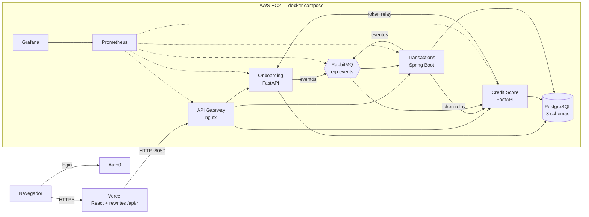
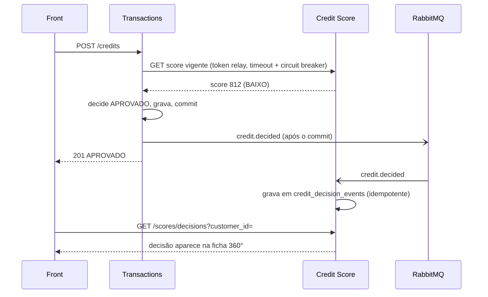

# Apresentação — Etapa 4

Slides em markdown (separados por `---`), para usar em Marp, reveal-md, Slidev ou colar no Google Slides.
Cada slide tem **notas do apresentador** e **quem fala**. Duração-alvo: ~15 min de slides e ~10 min de demo
([demo-etapa-4.md](demo-etapa-4.md)).

| Integrante                         | Slides                                        | Demo                                  |
| ---------------------------------- | --------------------------------------------- | ------------------------------------- |
| Murilo (murilozgodoy)              | 1 – Problema, 2 – Arquitetura                 | 1. Arquitetura                        |
| Lucas Bressanin                    | 3 – API Gateway                               | 2. Login e perfis (Auth0)             |
| Gabriel (GabrielRosa1)             | 4 – Eventos, 5 – Fluxo credit.decided         | 4. Fluxo de negócio e eventos         |
| João Vivacqua                      | 6 – Observabilidade                           | 3. Monitoramento e 5. Observabilidade |
| Vinicius (Vini8797)                | 7 – Testes de carga                           | 6. Rate limit e carga                 |
| João Baungartner (joaobaungartner) | 8 – Deploy, 9 – Qualidade, 10 – Padrões       | 7. Qualidade e entrega                |
| Todos                              | 11 – Lições e próximos passos, 12 – Perguntas | —                                     |

> A divisão é uma sugestão; ajustem ao que cada um mais trabalhou.

---

## 1. O problema

**ERP Banking e Crédito** — um banco digital que precisa:

- cadastrar clientes e sua situação financeira (anamnese);
- calcular **score de crédito** com regras intercambiáveis;
- abrir contas, movimentar saldo e **decidir pedidos de crédito** automaticamente;
- controlar quem pode fazer o quê (atendente, analista, admin).

**Etapa 4:** levar isso para produção — API Gateway, comunicação assíncrona, observabilidade, testes de carga e
deploy na nuvem.

> **Notas (Murilo):** contextualizar as etapas anteriores em 20 s (1: microsserviços, 2: integração,
> 3: Auth0 + front). O foco de hoje é "o que muda quando o sistema vai para produção".

---

## 2. Arquitetura final

- 3 microsserviços, **2 linguagens**, 1 banco com **schema por serviço**.
- Uma única porta pública para as APIs (8080); Grafana 8081 e Prometheus 8082.

> **Notas (Murilo):** percorrer o caminho de uma requisição: navegador → Vercel (mesma origem, sem CORS nem mixed
> content) → gateway → serviço. Síncrono por HTTP com token relay; o que não precisa de resposta imediata vai por
> evento.

---

## 3. API Gateway (nginx)

| Prefixo             | Destino            |
| ------------------- | ------------------ |
| `/onboarding/...`   | `onboarding-api`   |
| `/score/...`        | `credit-score-api` |
| `/transactions/...` | `transactions-api` |
| `/gateway/health`   | o próprio gateway  |

- **Rate limit:** 50 req/s por cliente (burst 100) + teto de 200 req/s por IP de conexão (burst 400, contra
  `X-Forwarded-For` forjado) → **429** JSON com `Retry-After`.
- **`X-Request-ID`** gerado/propagado — rastreia a requisição nos logs de todos os serviços.
- Serviço fora → **503** JSON padronizado; timeouts; logs JSON.
- `/metrics` e `/actuator` **não** são expostos (só o Prometheus, pela rede interna).
- O front trata 429/503/timeout com mensagem amigável e retentativa (respeita `Retry-After`).

> **Notas (Lucas):** o gateway é o único ponto de entrada: segurança (superfície menor), controle de abuso e
> observabilidade num lugar só. Mencionar que a Vercel reescreve `/api/*` para o gateway.

---

## 4. Comunicação assíncrona — RabbitMQ

Exchange **`erp.events`** (topic, durável), mensagens JSON persistentes com `event_id`, `event_type`, `occurred_at`.

| Evento                       | Produtor     | Consumidor   | Efeito                                        |
| ---------------------------- | ------------ | ------------ | --------------------------------------------- |
| `customer.created`           | Onboarding   | Transactions | abre conta corrente automaticamente           |
| `customer.anamnesis_updated` | Onboarding   | Score        | marca o score como desatualizado              |
| `credit.decided`             | Transactions | Score        | registra a decisão (`credit_decision_events`) |
| `transaction.created`        | Transactions | —            | auditoria / métricas                          |

- Publicar **nunca** derruba a requisição HTTP (loga + métrica de erro).
- Consumidores **idempotentes** por `event_id`; sem `RABBITMQ_URL` a mensageria vira no-op (dev e testes).

> **Notas (Gabriel):** por que eventos? Desacoplamento temporal: o Score não precisa estar no ar para o crédito ser
> decidido, e novos consumidores entram sem mexer no produtor.

---

## 5. Fluxo `credit.decided` ponta a ponta

> **Notas (Gabriel):** a resposta ao usuário não espera o evento. A ficha 360° faz polling e mostra a decisão
> "recebida via evento" segundos depois — é isso que vamos ver na demo.

---

## 6. Observabilidade — Prometheus + Grafana

- **Prometheus** coleta 7 jobs: os 3 serviços, nginx (exporter), RabbitMQ (geral e por fila) e ele mesmo.
- **Métricas de negócio:** `credit_decisions_total{status}`, `transactions_created_total{tipo}`,
  `score_evaluations_total`, `customers_created_total`, `events_published_total`, `events_consumed_total`.
- **6 dashboards provisionados:** Visão geral, Serviços Python, Transactions (JVM), Negócio, RabbitMQ, k6.
- **10 alertas:** serviço fora, nginx fora, 5xx > 5%, p95 > 500 ms (Python e Java), fila acumulando,
  erro ao publicar evento, pico de tráfego no gateway.
- No front, a página **/monitoramento** (admin) mostra a saúde dos serviços e do gateway com latência.

> **Notas (João Vivacqua):** "não dá para operar o que não se mede". Destacar que os dashboards são versionados
> (provisionamento), então qualquer um sobe o stack e já tem tudo.

---

## 7. Testes de carga — k6

Na EC2 (2 vCPU / 1,9 GB), pela rede do compose, fluxo de health (gateway + 3 serviços):

| Cenário    | VUs máx   | Req.    | req/s | p95     | 429   | Erros não-429 |
| ---------- | --------- | ------- | ----- | ------- | ----- | ------------- |
| smoke      | 2         | 477     | 7,9   | 11,3 ms | 0     | 0             |
| load       | 30        | 28.685  | 95,4  | 6,5 ms  | 28,2% | 0             |
| rate-limit | 100 req/s | 3.001   | 100,0 | 2,6 ms  | 1.401 | 0             |
| stress     | 120       | 152.245 | 281,6 | 4,4 ms  | 58,0% | ~5            |
| spike      | 150       | 43.333  | 270,8 | 4,7 ms  | 63,2% | 0             |

**Leitura:** todo o tráfego sai de **um IP** → acima de ~50 req/s o gateway devolve 429 **por desenho**. Zero 5xx,
p95 < 12 ms em tudo, nenhum serviço caiu; no spike o p99 foi a 141 ms e se recuperou.

> **Notas (Vinicius):** antecipar a pergunta "os thresholds falharam?": falharam só porque o k6 conta 429 como
> falha. Isso prova o rate limit; com `ALLOW_429=true` ou vários IPs mede-se a capacidade bruta. O fluxo de negócio
> autenticado está pronto e depende de um token real do Auth0.

---

## 8. Deploy

- **Imagens:** CI de cada repo publica no **GHCR** (`:latest` e `:<sha>`) a cada push na `main`; Dockerfiles com
  usuário não-root e `HEALTHCHECK`.
- **Back-end:** EC2 com `docker compose` (repo `erp-banking-infra`): gateway, 3 APIs, Postgres, RabbitMQ,
  Prometheus, Grafana, exporters. Script `deploy-ec2.sh`.
- **Front:** **Vercel** — <https://erp-banking-front.vercel.app>, com rewrites `/api/*` → gateway (resolve HTTPS →
  HTTP e CORS) e headers de segurança.
- **Auth0** como provedor de identidade (RBAC com 8 permissões e 3 perfis).

> **Notas (João Baungartner):** destacar que o compose aceita tanto `image:` (GHCR) quanto `build:` — o mesmo
> arquivo serve para dev local e produção.

---

## 9. Qualidade

| Repositório      | Testes | Cobertura                  | CI                                               |
| ---------------- | ------ | -------------------------- | ------------------------------------------------ |
| onboarding-api   | 61     | 98,87%                     | testes + cobertura, Docker, publish              |
| credit-score-api | 92     | 99,56%                     | testes + cobertura, Docker, publish              |
| transactions-api | 98     | 99,5% (instruções, JaCoCo) | testes + JaCoCo, publish                         |
| front            | 104    | 100% linhas, ~96% branches | lint, prettier, typecheck, testes, build, Docker |

- CI falha abaixo de **80%**; PRs curtos, merge só com CI verde; Conventional Commits.

> **Notas (João Baungartner):** testes de integração com mocks de broker/Auth0 rodam sem infraestrutura;
> mensageria desligada por padrão nos testes.

---

## 10. Padrões de projeto

| Padrão                      | Onde                                                                            |
| --------------------------- | ------------------------------------------------------------------------------- |
| **Strategy + Factory**      | Score: `SimpleRuleStrategy` / `WeightedStrategy` via `ScoreStrategyFactory`     |
| **API Gateway**             | nginx como ponto único de entrada, rate limit e request-id                      |
| **Publish/Subscribe**       | RabbitMQ topic `erp.events`, vários consumidores por evento                     |
| **Consumidor idempotente**  | `event_id` único em `credit_decision_events`; conta automática ignora duplicata |
| **Circuit Breaker + Retry** | Transactions → Score (timeout, retry, 503 claro)                                |
| **Token relay**             | serviços repassam o JWT do usuário nas chamadas síncronas                       |
| **Singleton / Repository**  | `RestTemplate` como bean; SQLAlchemy e Spring Data JPA                          |
| **Database per service**    | um schema por serviço; dados alheios só via API ou evento                       |

> **Notas (João Baungartner):** escolher dois para detalhar (Strategy e Circuit Breaker) se o tempo apertar.

---

## 11. Lições e próximos passos

**Lições**

- Mensageria opcional (no-op sem broker) deixou dev e testes simples.
- Contratos escritos antes (rotas, eventos, métricas) permitiram 4 frentes em paralelo sem quebrar nada.
- Rate limit por IP protege, mas atrapalha teste de carga de um único cliente.

**Próximos passos**

- **TLS** no gateway (domínio + Let's Encrypt) e fechar a porta HTTP.
- **DLQ** (dead-letter queue) e retentativas com backoff nos consumidores.
- **M2M** (client credentials do Auth0) entre serviços no lugar do token relay.
- **Escala horizontal:** réplicas atrás do gateway, Postgres/RabbitMQ gerenciados (RDS, Amazon MQ).
- Rate limit por usuário/token; tracing distribuído (OpenTelemetry) usando o `X-Request-ID`.

> **Notas (todos):** cada um cita uma lição do seu pedaço em uma frase.

---

## 12. Perguntas?

- Front: <https://erp-banking-front.vercel.app>
- Grafana: <http://3.235.6.136:8081> · Prometheus: <http://3.235.6.136:8082>
- Código: `github.com/murilozgodoy/erp-banking-*` e `github.com/GabrielRosa1/erp-banking-infra`
- Documentação: `erp-banking-front/docs/` ([etapa-4.md](etapa-4.md), [demo-etapa-4.md](demo-etapa-4.md))

> **Notas:** em seguida, a demo ao vivo seguindo o [roteiro](demo-etapa-4.md).
