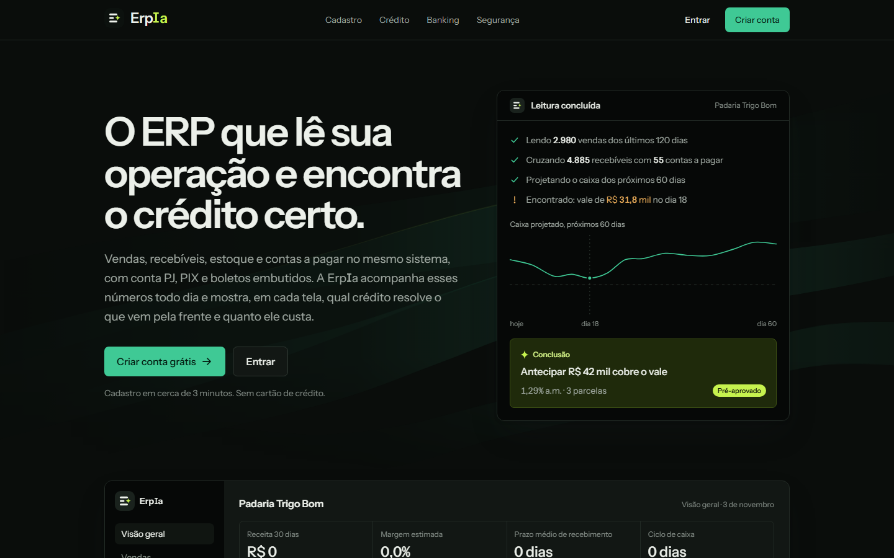
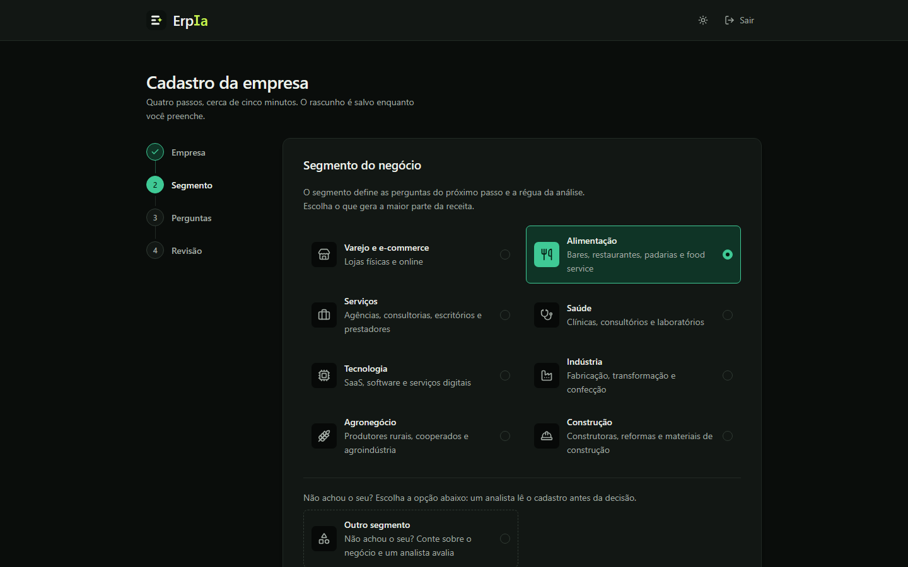
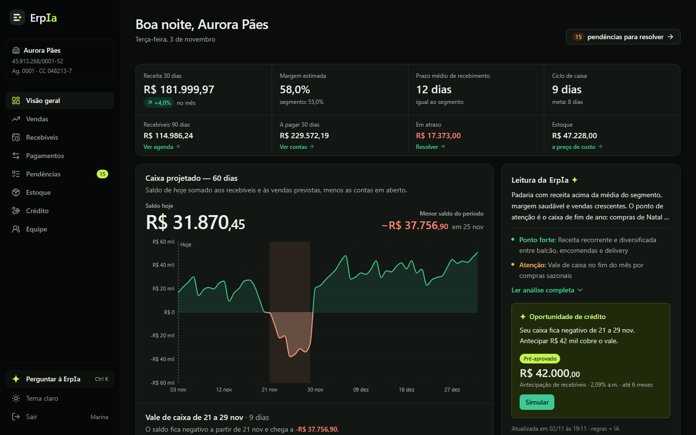
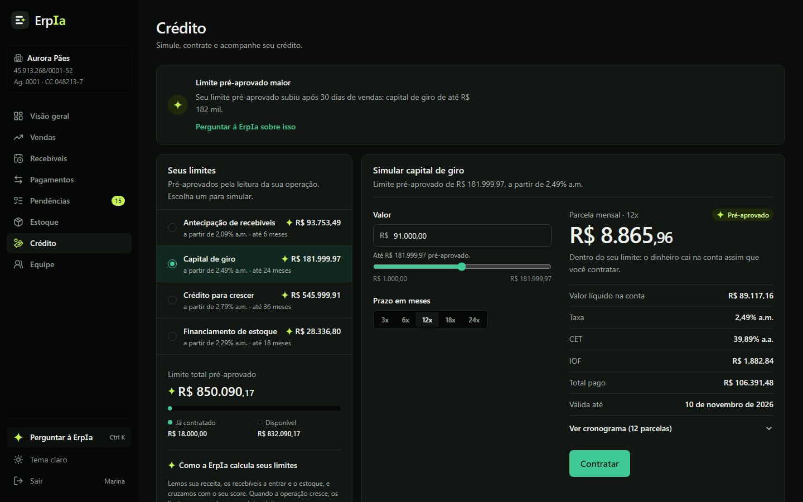
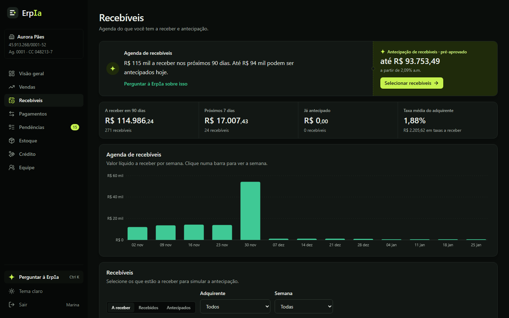
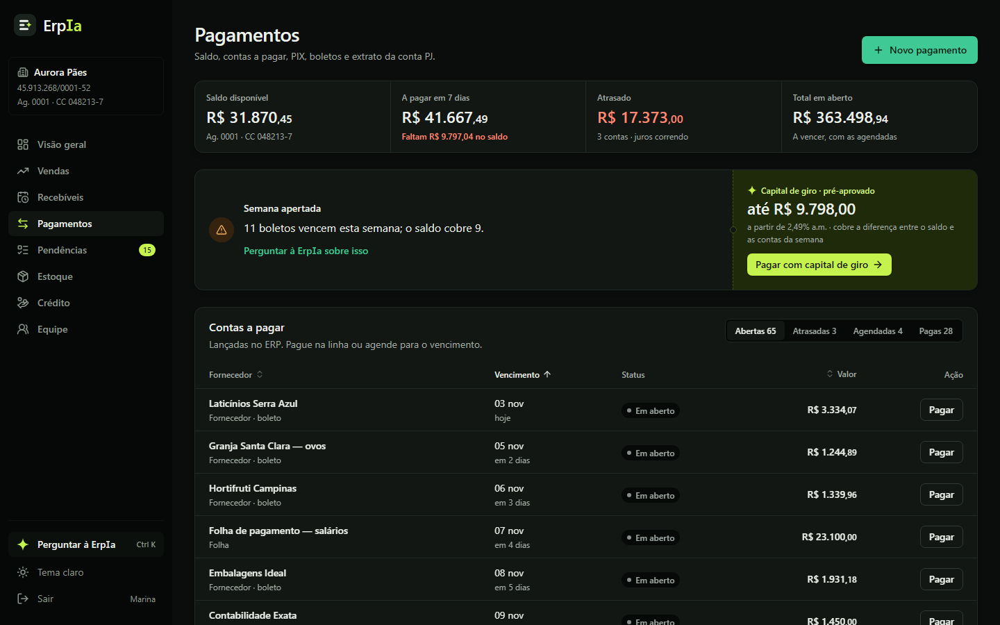
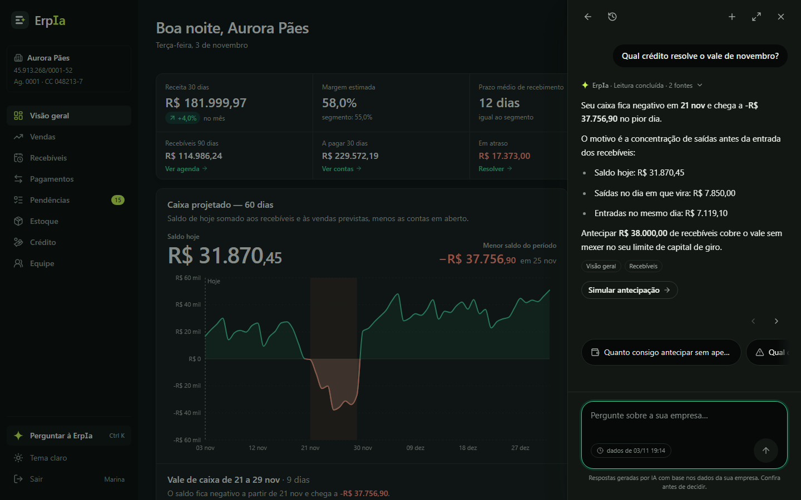
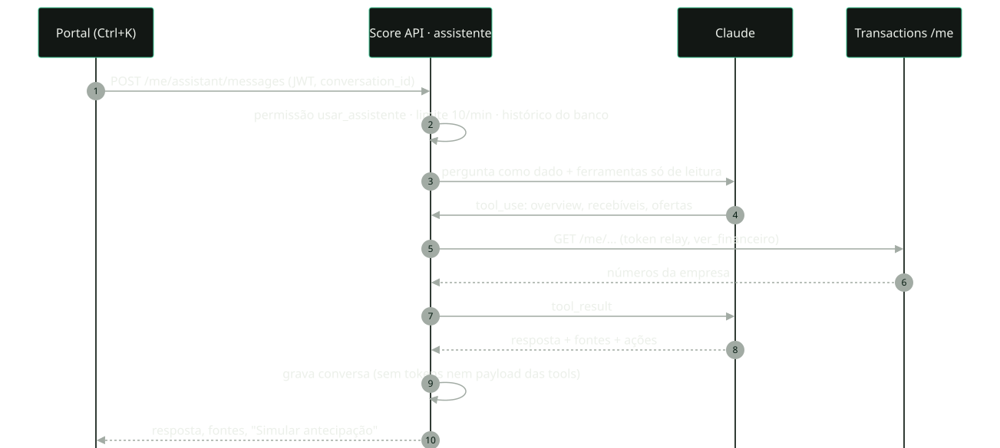

<!-- _class: lead -->
<!-- _paginate: false -->
<!-- _footer: '' -->

# ErpIa — ERP com banking e crédito inteligente

O ERP que lê a operação da empresa e encontra o crédito certo. Entrega final: Etapa 4 (produção) e Fase 2 (portal do cliente).

<strong>Murilo</strong> · <strong>Lucas</strong> · <strong>Gabriel</strong> · <strong>João Vivacqua</strong> · <strong>Vinicius</strong> · <strong>João Baungartner</strong>

<!--
Fala: Murilo (abertura, 20 s).
"Somos o grupo do ERP Banking e Crédito. Hoje mostramos a versão final: o que levamos para produção na Etapa 4 e o
produto que construímos em cima disso, a ErpIa, um ERP para pequenas empresas com conta PJ e crédito embutidos."

Arquivo-fonte (Marp). Exportar a partir da raiz do repo do front:
npx @marp-team/marp-cli@4.1.2 docs/apresentacao-final.md --theme docs/marp-erpia.css --html --allow-local-files --pdf
npx @marp-team/marp-cli@4.1.2 docs/apresentacao-final.md --theme docs/marp-erpia.css --html --allow-local-files --pptx
(CHROME_PATH apontando para o Chrome instalado.) Diagramas: docs/img/final/diagramas/*.mmd.
Duração-alvo: ~18 min de slides + ~8 min de demo.
-->

---

<!-- header: Murilo -->

## Quem fala o quê

**Murilo**
Problema, ErpIa
slides 3–4

**Lucas**
Arquitetura e Etapa 4
slides 5–7

**Gabriel**
Jornada do cliente, demo
slides 8–9, 18

**João Vivacqua**
Portal e crédito integrado
slides 10–11

**Vinicius**
Assistente, equipe
slides 12–14

**João Baungartner**
Qualidade, segurança, padrões
slides 15–17

Próximos passos e perguntas: todos.

<!--
Fala: Murilo. Só mostrar a divisão; não ler o slide.
-->

---

<!-- _class: dense -->

## O problema

A pequena empresa opera em **planilhas e três sistemas**: o ERP registra vendas e contas, o banco guarda o dinheiro e o crédito chega tarde, caro e sem contexto.

- O dono só descobre o **vale de caixa** quando o boleto vence.
- O banco não enxerga recebíveis, estoque nem sazonalidade, então o crédito vira **cheque especial**.
- Do lado do banco: cadastro, score, decisão de crédito e permissões precisam ser **auditáveis** e escalar.

### O que nos propusemos

Um único sistema que **registra a operação**, **movimenta o dinheiro** e **oferece o crédito certo no momento certo**, com regras explicáveis e IA só onde ela ajuda.

<!--
Fala: Murilo (1 min). Contextualizar as etapas: 1 microsserviços, 2 integração, 3 Auth0 + front,
4 produção. A Fase 2 transformou o backoffice do banco num produto para a empresa cliente.
-->

---

## A ErpIa

**ERP + conta PJ + crédito** num portal só, com backoffice para o banco.

- Vendas, recebíveis, estoque e contas a pagar.
- PIX, boletos e extrato da conta PJ.
- Em cada tela, o **crédito que resolve** aquele problema.
- Assistente que responde com os números da empresa.

<h4>Faísca</h4>

A estrela lima marca só o que a IA infere: insights, oportunidades e valores pré-aprovados.

Landing em produção: erp-banking-front.vercel.app

<!--
Fala: Murilo (1 min). A promessa da marca: "o ERP que lê a sua operação e encontra o crédito certo".
Explicar a Faísca: é o código visual que separa o que é dado do que é inferência da IA.
-->

---

<!-- header: Lucas -->
<!-- _class: diagram -->

## Arquitetura final

<!--
Fala: Lucas (1 min 30 s). Percorrer uma requisição: navegador → Vercel (mesma origem, sem CORS nem mixed
content) → gateway nginx na EC2 → um dos 3 microsserviços (2 linguagens). O síncrono vai por HTTP com token
relay; o que não precisa de resposta imediata vai por evento no RabbitMQ. O banco saiu do container: agora é um
Postgres gerenciado na Aiven (PG 18, SSL), com schema por serviço. Claude entra só no Score: análise do cadastro
e assistente. Prometheus raspa tudo pela rede interna; Grafana na 8081.
-->

---

## Etapa 4 · gateway e eventos

### API Gateway nginx

- Porta pública única (**8080**): `/onboarding`, `/score`, `/transactions`.
- Rate limit **50 req/s** por cliente + teto por IP → **429** com `Retry-After`.
- `X-Request-ID` em todos os logs; serviço fora → **503** JSON.
- `/metrics` e `/actuator` fora da internet.

### Assíncrono · RabbitMQ

- Exchange `erp.events` (topic, durável), envelope com `event_id`.
- `customer.created` abre a conta; `credit.decided` chega ao Score.
- Fase 2: `onboarding_submitted`, `analysis_completed`, `onboarding_reviewed`.
- Consumidores **idempotentes**; publicar nunca derruba o HTTP.

<!--
Fala: Lucas (1 min 30 s). Gateway: segurança, controle de abuso e observabilidade num lugar só. Eventos:
desacoplamento temporal — o Score não precisa estar no ar para o crédito ser decidido, e o seeder do ERP
roda em paralelo à análise do cadastro, consumindo o mesmo evento.
-->

---

## Etapa 4 · em produção

9/9containers saudáveis na EC2 3.235.6.136

7/7alvos do Prometheus up

6dashboards Grafana provisionados + Portal

14alertas (10 da Etapa 4 + 4 do portal)

**Deploy**
CI publica imagens no GHCR (`:latest` e `:sha`); EC2 com `docker compose`; front na **Vercel** com rewrites `/api/*`.

**Banco gerenciado**
**Aiven**, Postgres 18 com SSL. Pools de 2+1 conexões por serviço Python e 3 no Java, dentro do limite de 20.

**Observabilidade**
Métricas de negócio (decisões de crédito, análises, mensagens do assistente, tokens) e saúde em `/monitoramento`.

<!--
Fala: Lucas (1 min 30 s). Destacar a migração do banco para a Aiven: tiramos o Postgres da EC2 (2 vCPU / 1,9 GB) e
ajustamos os pools para caber em 20 conexões. O container local ficou como rollback. Dashboards versionados:
qualquer um sobe o stack e já tem tudo.
-->

---

<!-- header: Gabriel -->

## Jornada do cliente

~3<small> min</small>do cadastro ao envio

9segmentos com perguntas próprias

- Auth0 signup; a Post-Login Action dá o perfil **cliente**.
- 4 passos: empresa, **segmento**, perguntas, revisão.
- 8 a 14 campos por segmento; **rascunho salvo** a cada passo.
- Observações livres sobre o negócio vão para a análise.

<!--
Fala: Gabriel (1 min 30 s). O onboarding é rápido de propósito: valores aproximados bastam, a análise usa ordens de
grandeza. Segmentos: varejo, alimentação, serviços, saúde, tecnologia, indústria, agro, construção e "outro".
-->

---

## Análise: regras + LLM

### Regras, sempre

KPIs, score 0–1000, faixa de risco, insights e oportunidades com valor. Explicável e determinístico.

### LLM, quando ajuda

Claude lê dados e observações e devolve JSON: enquadramento, confiança, riscos. Timeout de 20 s; se falhar, ficam as regras.

### Fila manual

Segmento "outro", perfil específico, confiança < 0,6 ou regra crítica → analista decide em `/analises`.

<!--
Fala: Gabriel (1 min 30 s). A IA nunca aprova sozinha um caso fora do padrão: ela só pode mandar para revisão
humana. Em paralelo, o seeder do Transactions abre a conta PJ e gera 120 dias de ERP determinísticos para a
demo (2.980 vendas, 4.885 recebíveis, 55 contas a pagar no teste).
-->

---

<!-- header: João Vivacqua -->

## Portal · visão geral

<h4>Aurora Pães, em produção</h4>

R$ 31.870<small>,45</small>saldo da conta PJ

R$ 181.999<small>,97</small>receita 30 dias

742score · faixa MÉDIO

−R$ 38.324<small>,50</small>vale de caixa, 20 a 29/11

Antecipação pré-aprovada cobre o vale · 15 pendências abertas

Captura com dados de demonstração (mocks); os números ao lado são os da produção.

<!--
Fala: João Vivacqua (1 min 30 s). A visão geral responde "como está minha empresa e o que vem pela frente":
KPIs comparados ao segmento, caixa projetado de 60 dias e, ao lado, a leitura da ErpIa com a oportunidade de
crédito que resolve o vale. Tudo isso veio do onboarding + seeder + análise.
-->

---

## Crédito em cada tela

<strong>Crédito</strong> · simulador com parcelas Price, IOF e CET; limites por produto.

<strong>Recebíveis</strong> · agenda por adquirente; selecionar e antecipar.

<strong>Pagamentos</strong> · PIX, boleto e agendamento; pagar com capital de giro quando o saldo não cobre.

Precificação explicável — taxa base pela faixa (BAIXO 1,69% · MÉDIO 2,49% · ALTO 3,49% a.m.), ajuste por produto e limite pelo lastro: 80% dos recebíveis, 60% do estoque, 3× a receita.

<!--
Fala: João Vivacqua (1 min 30 s). Vendas, estoque e pendências seguem o mesmo princípio: cada aba tem um insight
e uma ação de crédito ligada ao problema daquela aba. O banking é real: pagar gera um débito na conta,
com comprovante.
-->

---

<!-- header: Vinicius -->

## Assistente ErpIa

<h4>Tool use seguro</h4>

Claude chama só ferramentas de <strong>leitura e simulação</strong> do Transactions, com o token do próprio
usuário. Nunca paga nem contrata.

- Até 6 chamadas de ferramenta por resposta; 10 mensagens/min.
- Responde com **fontes** e **ações** ("Simular antecipação").
- **Histórico no banco**: retomar, apagar uma ou todas (LGPD).
- **E2E aprovado** em produção com Claude real usando tools.

Ctrl+K abre o painel em qualquer tela do portal.

<!--
Fala: Vinicius (1 min 30 s). O prompt trata o texto do usuário como dado (proteção contra injection) e só responde
sobre a empresa e os produtos da ErpIa. O conteúdo das ferramentas não é salvo, só a resposta e as fontes.
Métricas: assistant_messages_total, assistant_tool_calls_total, tokens.
-->

---

<!-- _class: diagram -->

## Assistente · uma pergunta por dentro

<!--
Fala: Vinicius (45 s). Mostrar os dois limites de confiança: o Score valida permissão e limite antes de chamar o
modelo, e o Transactions valida ver_financeiro em cada ferramenta. O modelo nunca vê o token.
-->

---

## Equipe e permissões

O dono convida funcionários e decide **o que cada um pode fazer**. No Auth0 todos são `cliente`; as permissões finas ficam no nosso banco e o **back aplica**.

ver_financeiropagaraprovar_pagamentospedir_creditocontratar_creditogerenciar_estoquegerenciar_equipeusar_assistente

| Papel      | Preset                                    |
| ---------- | ----------------------------------------- |
| DONO/ADMIN | todas                                     |
| FINANCEIRO | pagar, aprovar, pedir crédito, assistente |
| OPERADOR   | pagar até um limite, estoque              |
| LEITURA    | só ver o financeiro                       |

<strong>Aprovação de pagamentos:</strong> acima do limite o pagamento fica
<em>pendente</em>, sem debitar, até outra pessoa aprovar. Convite por link de uso único (hash, 7 dias).

<!--
Fala: Vinicius (1 min). Regra dos quatro olhos: quem paga não aprova o próprio pagamento. Sem permissão, o botão
aparece desabilitado com o motivo, em vez de sumir. Auditoria: created_by e approved_by.
-->

---

<!-- header: João Baungartner -->

## Qualidade e carga

97–99%cobertura nos 4 repos (CI falha abaixo de 80%)

426<small> ms</small>p95 do fluxo de negócio autenticado, 30 VUs

0respostas 5xx em todos os cenários

~280<small> req/s</small>sustentados pelo gateway no stress

**CI em todo PR:** lint, format, typecheck, testes com cobertura, build Docker e publish no GHCR. Merge só com CI verde; Conventional Commits.

**k6 na EC2:** smoke, load, rate-limit, stress e spike (p95 < 12 ms) + fluxo de negócio com token real do Auth0 (cliente → score → conta → crédito). Os 429 são o rate limit funcionando: todo o tráfego sai de um IP.

<!--
Fala: João Baungartner (1 min 30 s). O business flow escreve no Postgres gerenciado e publica eventos; mesmo assim
p95 de 426 ms numa instância de 2 vCPU / 1,9 GB. Se perguntarem dos thresholds: só falham porque o k6 conta 429
como falha; com ALLOW_429 o p95 < 500 ms passou.
-->

---

<!-- _class: dense -->

## Segurança

### Identidade

Auth0 com RBAC: perfis de staff e **cliente**, Post-Login Action para signup self-service. Permissões no JWT, checadas em cada serviço.

### Entre serviços

**Token relay**: o JWT do usuário segue nas chamadas síncronas. Gateway como única porta, rate limit e métricas internas.

### Dados e eventos

**Outbox transacional** no Onboarding: evento gravado na mesma transação e republicado se o broker cair. Consumidores idempotentes.

### IA

Texto do usuário tratado como dado (proteção contra prompt injection), ferramentas só de leitura, sem tokens no histórico.

### Segredos

Fora do git: `.env` da EC2, variáveis da Vercel e do Auth0. A chave da Anthropic nunca vai para log nem resposta.

### Conexões

Postgres com SSL na Aiven; HTTPS na Vercel; headers de segurança; convites guardados só como hash.

<!--
Fala: João Baungartner (1 min 30 s). Escolher dois para aprofundar se o tempo apertar: token relay e outbox.
-->

---

<!-- _class: dense -->

## Padrões de projeto

| Padrão                                | Onde                                                                                    |
| ------------------------------------- | --------------------------------------------------------------------------------------- |
| **Strategy + Factory**                | Score: estratégias de score; `BusinessAnalyzer` com `RuleBasedAnalyzer` e `LlmAnalyzer` |
| **API Gateway**                       | nginx: ponto único de entrada, rate limit, request-id                                   |
| **Publish/Subscribe**                 | RabbitMQ `erp.events`, vários consumidores por evento                                   |
| **Transactional Outbox**              | Onboarding: `outbox_events` + relay com `FOR UPDATE SKIP LOCKED`                        |
| **Consumidor idempotente**            | `event_id` único; seeder e análise não refazem trabalho                                 |
| **Circuit Breaker + Retry**           | Transactions → Score (timeout, retry, 503 claro)                                        |
| **Token relay**                       | serviços e ferramentas do assistente repassam o JWT do usuário                          |
| **Repository · Database per service** | SQLAlchemy e Spring Data JPA; um schema por serviço                                     |

<!--
Fala: João Baungartner (1 min). Novidade da Fase 2: a mesma Strategy do score foi reaproveitada para a análise
do negócio, com o LLM como estratégia opcional (sem chave, só regras).
-->

---

<!-- header: Gabriel -->

## Demo · roteiro

1 · Landing e cadastro<h3>Criar conta</h3>
Signup no Auth0, perfil cliente pela Action, onboarding de alimentação em ~3 min.

2 · Análise<h3>Regras + IA</h3>
Status com timeline; um caso "outro" cai na fila e o analista aprova em /analises.

3 · Portal<h3>Aurora Pães</h3>
Visão geral, vale de caixa, antecipação pré-aprovada, simulador e um PIX.

4 · Assistente<h3>Ctrl+K</h3>
"Qual crédito resolve o vale de novembro?" com ferramentas e fontes.

5 · Equipe<h3>Convite</h3>
Operador com limite: o pagamento acima dele fica pendente de aprovação.

6 · Operação<h3>Grafana</h3>
Dashboards Portal e k6, métricas de negócio e do assistente.

<!--
Fala: Gabriel conduz a demo (~8 min); cada integrante assume o passo do seu tema:
1 Murilo, 2 Gabriel, 3 João Vivacqua, 4 Vinicius, 5 Vinicius/João Baungartner, 6 Lucas.
Plano B: se a rede falhar, mostrar as capturas destes slides e o vídeo local.
-->

---

<!-- header: Todos -->

## Próximos passos

### Plataforma

- **TLS no gateway** (domínio + Let's Encrypt) e fechar a porta HTTP.
- **DLQ** e retentativas com backoff nos consumidores.
- **M2M** (client credentials) entre serviços no lugar do token relay.
- Réplicas atrás do gateway; RabbitMQ gerenciado; tracing com OpenTelemetry.

### Produto

- Open Finance para importar extratos e recebíveis reais.
- Envio de convites e alertas por e-mail.
- Assistente com streaming e ações confirmadas pelo usuário.
- Contratação de crédito com assinatura e formalização.

<!--
Fala: todos (1 min). Cada um cita uma lição do seu pedaço em uma frase. Sugestões:
Murilo — contratos escritos antes (PORTAL_CLIENTE.md) deixaram 4 frentes em paralelo;
Lucas — mensageria opcional (no-op sem broker) simplificou dev e testes;
Gabriel — regras primeiro, LLM como complemento;
João Vivacqua — mocks com o contrato exato destravaram o front;
Vinicius — tool use só de leitura é o limite certo para um assistente financeiro;
João Baungartner — rate limit por IP atrapalha teste de carga de um cliente só.
-->

---

<!-- _class: lead -->
<!-- _paginate: false -->
<!-- _footer: '' -->
<!-- header: '' -->

# Perguntas

Front <strong>erp-banking-front.vercel.app</strong> · Gateway <strong>3.235.6.136:8080</strong> · Grafana <strong>3.235.6.136:8081</strong>

Código em github.com/murilozgodoy/erp-banking-* · documentação em erp-banking-front/docs/

<!--
Fala: todos. Abrir para perguntas. Se sobrar tempo, voltar ao slide de arquitetura.
-->
