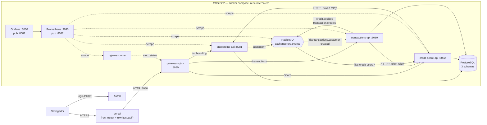

# Etapa 4 — Gateway, eventos, métricas, carga e deploy (entrega 04/11/2026)

## Escopo

- **API Gateway** (nginx) como única entrada das APIs, com rate limit.
- **Comunicação assíncrona** entre os serviços (RabbitMQ).
- **Observabilidade** com Prometheus e Grafana.
- **Testes de carga** com k6.
- **Deploy**: back na AWS EC2 (Docker Compose) e front na Vercel.

A infraestrutura fica no repositório
[erp-banking-infra](https://github.com/GabrielRosa1/erp-banking-infra) (`docker-compose.yml`, `gateway/`,
`prometheus/`, `grafana/`, `rabbitmq/`, `load-tests/` e `scripts/`). Detalhes de operação estão em
`erp-banking-infra/docs/deploy-ec2.md` e `erp-banking-infra/docs/observabilidade.md`.

## Produção

| O quê                 | URL                                                                                             |
| --------------------- | ----------------------------------------------------------------------------------------------- |
| Front (Vercel)        | <https://erp-banking-front.vercel.app>                                                          |
| API Gateway (EC2)     | `http://3.235.6.136:8080` (o front usa os rewrites `/api/*` da Vercel)                          |
| Grafana (EC2)         | `http://3.235.6.136:8081`                                                                       |
| Prometheus (EC2)      | `http://3.235.6.136:8082`                                                                       |
| Swagger (via gateway) | `http://3.235.6.136:8080/onboarding/docs`, `/score/docs`, `/transactions/swagger-ui/index.html` |

## Arquitetura final



| Container          | Porta interna | Porta publicada na EC2       |
| ------------------ | ------------- | ---------------------------- |
| `gateway` (nginx)  | 80            | **8080** (única entrada)     |
| `grafana`          | 3000          | **8081**                     |
| `prometheus`       | 9090          | **8082**                     |
| `onboarding-api`   | 8081          | — (só rede interna)          |
| `credit-score-api` | 8082          | —                            |
| `transactions-api` | 8080          | —                            |
| `postgres`         | 5432          | — (acesso por túnel SSH)     |
| `rabbitmq`         | 5672 / 15672  | — (management por túnel SSH) |
| `nginx-exporter`   | 9113          | —                            |

As chamadas síncronas continuam por HTTP com **token relay** (Score → Onboarding, Transactions → Score). O que
não precisa de resposta imediata passa a ir por **eventos** no RabbitMQ.

## API Gateway

Configuração em `erp-banking-infra/gateway/` (nginx 1.27).

| Prefixo público     | Destino                     | Observação                                      |
| ------------------- | --------------------------- | ----------------------------------------------- |
| `/onboarding/...`   | `onboarding-api:8081/...`   | prefixo removido (strip)                        |
| `/score/...`        | `credit-score-api:8082/...` | prefixo removido                                |
| `/transactions/...` | `transactions-api:8080/...` | prefixo removido                                |
| `/gateway/health`   | o próprio nginx             | 200 `{"status":"UP"}`                           |
| qualquer outra      | —                           | 404 `{"detail":"Not Found","request_id":"..."}` |

Exemplo: `GET /score/scores/customers/1/latest` → `credit-score-api:8082/scores/customers/1/latest`.

- **Rate limit por IP:** 50 req/s com burst de 100 (`nodelay`). Atrás da Vercel o IP considerado é o primeiro do
  `X-Forwarded-For`. Em excesso: **429** `{"detail":"Too Many Requests","request_id":"..."}` com `Retry-After: 1`.
- **Serviço fora do ar:** 502/503/504 do upstream viram **503** `{"detail":"Service Unavailable","request_id":"..."}`.
  Corpo acima de 2 MB: 413. Além do gateway, o Transactions responde **503** em `POST /credits` quando o Score
  está fora (timeout + retry + circuit breaker na chamada ao Score).
- **Headers:** `X-Request-ID` reaproveitado do cliente ou gerado, repassado ao serviço e devolvido na resposta;
  `X-Forwarded-For/Proto/Host/Port/Prefix` e `X-Real-IP` para os serviços.
- **Timeouts:** conexão 5 s, leitura/envio 30 s.
- **Não expostos:** `/metrics` e `/actuator/**` dos serviços devolvem 404 no gateway; só o Prometheus os acessa
  pela rede interna. O `stub_status` do nginx fica numa porta interna para o exporter.
- **CORS:** continua nos serviços (`CORS_ORIGINS`); o gateway só repassa. Com os rewrites da Vercel o navegador
  fala só com o domínio da Vercel, sem CORS.
- **Logs:** JSON no stdout, com `request_id`, status e tempos de upstream.
- As APIs Python usam `ROOT_PATH` (`/onboarding`, `/score`) para o Swagger (`/docs`) funcionar atrás do gateway.

## Comunicação assíncrona (RabbitMQ)

- Exchange **`erp.events`**, tipo `topic`, durável; mensagens JSON persistentes. Exchange, filas e bindings são
  declarados em `erp-banking-infra/rabbitmq/definitions.json`.
- Todo evento tem `event_id` (UUID), `event_type` e `occurred_at` (ISO-8601 UTC), em `snake_case`.
- Ativado por `RABBITMQ_URL`; vazio = mensageria desligada (no-op), para dev e testes rodarem sem broker.
- Falha ao publicar **nunca** quebra a requisição HTTP: o erro é logado e contado em
  `events_published_total{result="error"}`. O Transactions publica depois do commit da transação no banco.

| Routing key                  | Produtor     | Fila / consumidor                              | Efeito                                                                                |
| ---------------------------- | ------------ | ---------------------------------------------- | ------------------------------------------------------------------------------------- |
| `credit.decided`             | Transactions | `credit-score.credit-decided` → Score          | grava em `credit_decision_events`                                                     |
| `customer.anamnesis_updated` | Onboarding   | `credit-score.anamnesis-updated` → Score       | marca o score como desatualizado                                                      |
| `transaction.created`        | Transactions | — (visível no RabbitMQ e no Grafana)           | —                                                                                     |
| `customer.created`           | Onboarding   | `transactions.customer-created` → Transactions | abre conta corrente com saldo zero (`AUTO_OPEN_ACCOUNT=true` no compose; idempotente) |

### Tabelas novas no schema `credit_score`

- `credit_decision_events` (event_id UNIQUE, credit_request_id, customer_id, status, motivo, valor_solicitado,
  prazo_meses, score, faixa_risco, taxa_juros, occurred_at, received_at). Idempotente por `event_id`: a mesma
  mensagem entregue duas vezes não duplica o registro. Exposta em `GET /scores/decisions?customer_id=`.
- `customer_score_status` (customer_id, desatualizado, dividas_ativas, comprometimento_renda, last_event_id,
  updated_at). Exposta em `GET /scores/customers/{id}/status`.

O consumidor do Score (aio-pika) roda em background no lifespan da API; mensagem com erro volta para a fila uma
vez (`nack` com requeue só na primeira entrega). Contagem em `events_consumed_total{routing_key,result}`.

## Métricas (Prometheus + Grafana)

Endpoints de métricas (públicos, sem token, mas só alcançáveis pela rede interna):

- Onboarding e Score: `GET /metrics` (`prometheus-fastapi-instrumentator`).
- Transactions: `GET /actuator/prometheus` e `GET /actuator/health` (Micrometer, tag
  `application=transactions-api`).

Alvos do Prometheus (scrape a cada 15 s), em `erp-banking-infra/prometheus/prometheus.yml`:

| Job                 | Alvo                                         |
| ------------------- | -------------------------------------------- |
| `onboarding-api`    | `onboarding-api:8081/metrics`                |
| `credit-score-api`  | `credit-score-api:8082/metrics`              |
| `transactions-api`  | `transactions-api:8080/actuator/prometheus`  |
| `gateway`           | `nginx-exporter:9113/metrics`                |
| `rabbitmq`          | `rabbitmq:15692/metrics`                     |
| `rabbitmq-detailed` | `rabbitmq:15692/metrics/detailed` (por fila) |
| `prometheus`        | `localhost:9090`                             |

O k6 envia as métricas dos testes de carga por remote write (`k6_*`).

**Métricas de negócio** (nomes fixos; os dashboards dependem deles):

| Métrica                                                      | Serviço                  |
| ------------------------------------------------------------ | ------------------------ |
| `credit_decisions_total{status="APROVADO\|REVISAO\|NEGADO"}` | Transactions             |
| `transactions_created_total{tipo}`                           | Transactions             |
| `score_evaluations_total{strategy,faixa_risco}`              | Score                    |
| `customers_created_total`                                    | Onboarding               |
| `events_published_total{routing_key,result}`                 | Transactions, Onboarding |
| `events_consumed_total{routing_key,result}`                  | Score, Transactions      |

**Métricas HTTP** (usadas nos dashboards de latência e erro):

- Python: `http_requests_total{handler,method,status}`, `http_request_duration_seconds` e
  `http_request_duration_highr_seconds` (histograma de alta resolução).
- Java: `http_server_requests_seconds` (histograma, com `uri`, `method`, `status`).

**Dashboards** provisionados no Grafana (pasta "ERP Banking", `erp-banking-infra/grafana/dashboards/`):

| Dashboard                            | O que mostra                                                                     |
| ------------------------------------ | -------------------------------------------------------------------------------- |
| ERP Banking — Visão geral            | UP/DOWN, req/s, p95 e 5xx por serviço, gateway, eventos e RabbitMQ               |
| ERP Banking — Serviços Python        | Onboarding e Score por handler: req/s, status, latência, CPU e memória           |
| ERP Banking — Transactions API (JVM) | HTTP por URI, memória JVM, threads, GC, CPU e pool HikariCP                      |
| Negócio                              | Clientes, transações, decisões de crédito, taxa de aprovação, score e eventos    |
| ERP Banking — RabbitMQ               | Profundidade e consumidores por fila, publish/deliver/ack, conexões, memória     |
| ERP Banking — Testes de carga (k6)   | VUs, req/s por status, p95/p99, p95 por endpoint, falhas e checks (por `testid`) |

Alertas (`prometheus/alerts.yml`, visíveis em `/alerts` do Prometheus): serviço fora do ar, nginx fora do ar,
taxa de 5xx acima de 5%, p95 acima de 500 ms, fila acumulando mensagens, erro ao publicar evento e pico de tráfego
no gateway.

## Testes de carga (k6)

Os cenários ficam em `erp-banking-infra/load-tests/` e rodam com a imagem Docker `grafana/k6` (sem instalar
nada), sempre contra o **gateway**.

| Cenário      | VUs         | Duração | p(95)        | Erro HTTP           | Checks                |
| ------------ | ----------- | ------- | ------------ | ------------------- | --------------------- |
| `smoke`      | 2           | 1 min   | < 500 ms     | < 1%                | > 99%                 |
| `load`       | 0 → 30      | ~5 min  | < 500 ms     | < 1%                | > 99%                 |
| `stress`     | 0 → 120     | ~9 min  | < 1500 ms    | < 5%                | > 95%                 |
| `spike`      | 5 → 150 → 5 | ~3 min  | < 1500 ms    | < 5%                | > 95%                 |
| `rate-limit` | 100 req/s   | 30 s    | 429 < 200 ms | < 1% (fora 200/429) | exige ao menos um 429 |

- **Com token** (`ACCESS_TOKEN` de um usuário `admin`, copiado em **Meu perfil**): fluxo de negócio completo
  (cliente → anamnese → score → conta → transação → crédito). **Sem token** (`AUTH_MODE=none`): só os `/health`.
- O fluxo de negócio cria dados de verdade; rode em ambiente de demonstração.
- Todo o tráfego do k6 sai de um único IP, então em load/stress/spike parte das respostas pode virar 429 (é o
  rate limit funcionando). `ALLOW_429=true` faz o 429 não contar como erro.

```bash
cd erp-banking-infra/load-tests
AUTH_MODE=none ./run.sh smoke                  # só health
ACCESS_TOKEN='eyJ...' ./run.sh load             # fluxo de negócio
K6_NETWORK=erp-banking-infra_erp ACCESS_TOKEN='eyJ...' ./run.sh stress   # na EC2, dentro da rede do compose
```

No Windows: `.\run.ps1 smoke` (mesmos cenários e variáveis). Cada execução gera
`erp-banking-infra/load-tests/results/<cenario>-summary.md` (e `.json`); os resultados e os prints do Grafana
ficam nessa pasta, e o README de `load-tests/` tem a tabela-resumo a preencher. Durante o teste, o dashboard **k6**
do Grafana (filtrado pelo `testid` impresso pelo runner) mostra a execução ao vivo.

## Testes de carga — resultados

> Execução contra o gateway na EC2 (`http://3.235.6.136:8080`). Números preenchidos a partir dos relatórios em
> `erp-banking-infra/load-tests/results/<cenario>-summary.md`.

| Cenário      | Data | VUs / taxa | Requisições | req/s | p(95) | p(99) | Erro HTTP | 429 | Thresholds |
| ------------ | ---- | ---------- | ----------- | ----- | ----- | ----- | --------- | --- | ---------- |
| `smoke`      | —    | 2          | —           | —     | —     | —     | —         | —   | —          |
| `load`       | —    | 0 → 30     | —           | —     | —     | —     | —         | —   | —          |
| `stress`     | —    | 0 → 120    | —           | —     | —     | —     | —         | —   | —          |
| `spike`      | —    | 5 → 150    | —           | —     | —     | —     | —         | —   | —          |
| `rate-limit` | —    | 100 req/s  | —           | —     | —     | —     | —         | —   | —          |

**Análise:** _(a preencher com os resultados: gargalo observado, comportamento do rate limit, uso de CPU/memória
da EC2 no Grafana e o que mudaria para escalar.)_

## Qualidade (CI e cobertura)

Situação da `main` em 03/11/2026 (~15:10 UTC). Em todos os repositórios o CI falha se a cobertura cair abaixo de
80%; as imagens são publicadas no GHCR a cada push na `main`.

| Repositório                    | Testes                                                    | Cobertura                                       | CI (último push na `main`)                        | Imagem                                                     |
| ------------------------------ | --------------------------------------------------------- | ----------------------------------------------- | ------------------------------------------------- | ---------------------------------------------------------- |
| `erp-banking-onboarding-api`   | 61 (pytest)                                               | 98,87% (pytest-cov)                             | ✅ testes + cobertura, build Docker, publish      | `ghcr.io/murilozgodoy/erp-banking-onboarding-api:latest`   |
| `erp-banking-credit-score-api` | 92 (pytest)                                               | 99,56% (pytest-cov)                             | ✅ testes + cobertura, build Docker, publish      | `ghcr.io/murilozgodoy/erp-banking-credit-score-api:latest` |
| `erp-banking-transactions-api` | 98 (JUnit 5)                                              | 99,5% das instruções (JaCoCo)                   | ✅ testes + JaCoCo, publish                       | `ghcr.io/murilozgodoy/erp-banking-transactions-api:latest` |
| `erp-banking-front`            | 102 em 29 arquivos (Vitest)                               | 100% linhas/statements/funções, 95,62% branches | ✅ lint + testes + cobertura, build Docker, build | — (deploy na Vercel)                                       |
| `erp-banking-infra`            | — (configuração: compose, nginx, Prometheus, Grafana, k6) | —                                               | —                                                 | usa as imagens acima                                       |

## Deploy

### Back-end na EC2

Passo a passo completo em `erp-banking-infra/docs/deploy-ec2.md`. Resumo:

1. Instância EC2 (`t3.small` ou maior, Amazon Linux 2023 ou Ubuntu) com Elastic IP (`3.235.6.136`).
2. Security Group: 8080, 8081 e 8082 abertas (gateway, Grafana e Prometheus publicados pelo compose; a Vercel
   precisa alcançar a 8080), 22 só para o seu IP. Para restringir Grafana/Prometheus ao grupo, limite 8081/8082
   aos IPs do grupo no Security Group. Nunca abrir 5432, 5672 ou 15672.
3. Na instância:

   ```bash
   curl -fsSL https://raw.githubusercontent.com/GabrielRosa1/erp-banking-infra/main/scripts/deploy-ec2.sh -o deploy-ec2.sh
   bash deploy-ec2.sh            # ou --no-build para só puxar as imagens do GHCR
   ```

   O script instala Docker, clona os repositórios lado a lado em `~/erp-banking/`, cria o `.env` do infra a partir
   do `.env.example`, sobe o `docker compose` e espera os health checks.

4. Revisar `~/erp-banking/erp-banking-infra/.env`: `AUTH0_DOMAIN`, `AUTH0_AUDIENCE`, `CORS_ORIGINS` e
   `CORS_ORIGINS_JSON` (com `https://erp-banking-front.vercel.app`), senhas do Grafana, Postgres e RabbitMQ.
5. Validar com `./scripts/smoke.sh` (health) ou `ACCESS_TOKEN='eyJ...' ./scripts/smoke.sh` (fluxo completo, que
   também confere o evento `credit.decided` em `GET /score/scores/decisions`).

As imagens são publicadas pelo job `publish` do CI de cada API em `ghcr.io/murilozgodoy/<repo>`. O infra também
tem o workflow `deploy.yml` (SSH com os secrets `EC2_HOST`, `EC2_USER`, `EC2_SSH_KEY`).

### Front na Vercel

Projeto `gabrielrosa1s-projects/erp-banking-front`. O `vercel.json` deste repositório define:

- **Rewrites** `/api/onboarding|score|transactions|gateway/:path*` → `http://3.235.6.136:8080/<svc>/:path*`. O
  navegador só fala HTTPS com a Vercel e a Vercel chama a EC2 por HTTP: evita _mixed content_ e dispensa CORS.
- **Fallback SPA** para o `index.html` (rotas do React Router).
- **Headers de segurança** (`X-Content-Type-Options`, `X-Frame-Options`, `Referrer-Policy`, `Permissions-Policy`,
  `Strict-Transport-Security`) e cache longo para `/assets/*`.

Variáveis de ambiente do projeto na Vercel (Production):

| Variável                    | Valor                     |
| --------------------------- | ------------------------- |
| `VITE_ONBOARDING_API_URL`   | `/api/onboarding`         |
| `VITE_SCORE_API_URL`        | `/api/score`              |
| `VITE_TRANSACTIONS_API_URL` | `/api/transactions`       |
| `VITE_GATEWAY_URL`          | `/api`                    |
| `VITE_GRAFANA_URL`          | `http://3.235.6.136:8081` |
| `VITE_PROMETHEUS_URL`       | `http://3.235.6.136:8082` |
| `VITE_API_TIMEOUT_MS`       | `15000`                   |
| `VITE_AUTH0_DOMAIN`         | domínio do tenant Auth0   |
| `VITE_AUTH0_CLIENT_ID`      | Client ID da SPA          |
| `VITE_AUTH0_AUDIENCE`       | `https://erp-banking-api` |

Deploy:

```bash
npm i -g vercel
vercel link                    # escolher gabrielrosa1s-projects/erp-banking-front
vercel deploy --prod --yes
```

As variáveis `VITE_*` entram no bundle no momento do build: depois de alterar alguma na Vercel, é preciso fazer
um novo deploy. Se o IP da EC2 mudar, atualize o `vercel.json` e faça redeploy.

No **Auth0** (Application SPA), a URL `https://erp-banking-front.vercel.app` precisa estar em **Allowed Callback
URLs**, **Allowed Logout URLs** e **Allowed Web Origins** (passo manual no painel; ver [auth0.md](auth0.md)).

## O que mudou no front

| Mudança                     | Detalhe                                                                                                                                                                                                                               |
| --------------------------- | ------------------------------------------------------------------------------------------------------------------------------------------------------------------------------------------------------------------------------------- |
| URLs pelo gateway           | `.env.example` com 3 modos: local pelo gateway (`http://localhost:8080/<svc>`, padrão), local sem gateway (portas 8081/8082/8080) e Vercel (`/api/<svc>`)                                                                             |
| Ficha 360°                  | Card **"Decisões registradas via evento"** (`GET /scores/decisions?customer_id=`), mostrando as decisões de crédito que chegaram ao Score pelo RabbitMQ                                                                               |
| Score desatualizado         | Aviso na ficha quando `GET /scores/customers/{id}/status` indica que a anamnese mudou depois da última avaliação                                                                                                                      |
| `/monitoramento`            | Só para `admin` (as 8 permissões): health dos 3 serviços e do gateway (`/gateway/health`) com latência, atualizado a cada 10 s, e links para Grafana, Prometheus e Swagger                                                            |
| Erros e retentativas        | Mensagens amigáveis para 429, 503, 504 e timeout. Consultas retentam até 2 vezes (inclusive 429); escritas só retentam o 429, uma vez. O `Retry-After` do gateway é respeitado até 10 s; sem ele, backoff exponencial (1 s, 2 s, ...) |
| Painel inicial              | Indicadores na home: clientes (e quantos têm anamnese), contas (ativas e saldo total) e pedidos de crédito por decisão, cada um conforme a permissão de leitura                                                                       |
| Variáveis novas (opcionais) | `VITE_GATEWAY_URL`, `VITE_GRAFANA_URL`, `VITE_PROMETHEUS_URL`; vazias = o item correspondente não aparece                                                                                                                             |
| Deploy                      | `vercel.json` com rewrites, fallback SPA e headers de segurança                                                                                                                                                                       |

## Checklist de entrega

- [x] Gateway roteando os 3 serviços, com rate limit (429) e `X-Request-ID`
- [x] Prometheus coletando os alvos; Grafana com dashboards provisionados
- [x] Evento `credit.decided` Transactions → RabbitMQ → Score, exibido na ficha 360° do front
- [x] Evento `customer.anamnesis_updated` Onboarding → RabbitMQ → Score (score desatualizado)
- [x] Cenários de carga k6 (smoke, load, stress, spike, rate-limit) com thresholds
- [ ] Relatório das execuções de carga em `erp-banking-infra/load-tests/results`
- [x] Back rodando na EC2 via compose; front na Vercel falando com a EC2 pelo rewrite
- [ ] Login Auth0 na URL da Vercel (adicionar a URL no painel do Auth0)
- [x] CI verde e cobertura ≥ 80% nos 4 repositórios de código (ver [Qualidade](#qualidade-ci-e-cobertura))
- [x] Documentação: este arquivo, [apis.md](apis.md), [ambiente-dev.md](ambiente-dev.md) e READMEs

## Como demonstrar

Roteiro completo, passo a passo e com as URLs reais: [demo-etapa-4.md](demo-etapa-4.md). Resumo:

1. Abrir <https://erp-banking-front.vercel.app> e entrar com um usuário `admin`.
2. **Monitoramento:** os 3 serviços e o gateway `UP`, com latência; abrir o Grafana pelo link.
3. Cadastrar cliente → anamnese → calcular score → abrir conta → transação → solicitar crédito.
4. Na ficha do cliente, o card "Decisões registradas via evento" mostra a decisão que chegou pelo RabbitMQ;
   alterar a anamnese faz aparecer o aviso de score desatualizado.
5. No Grafana, dashboards **Negócio** e **Visão geral** refletem as operações; no **RabbitMQ**, as filas.
6. Rodar `./run.sh rate-limit` (ou `smoke`/`load`) e mostrar o 429 e o dashboard **k6**.
