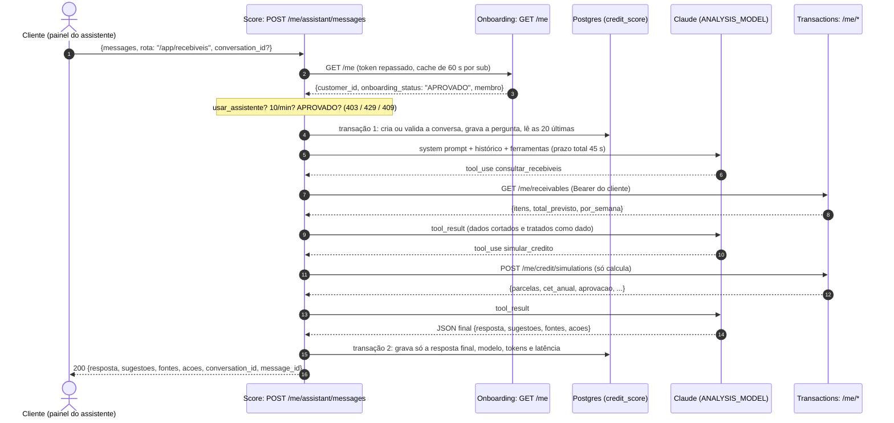

# Fase 2 — Portal do Cliente ErpIa

Documento de entrega da Fase 2. Descreve o que está no `main` dos quatro repositórios (front, Onboarding,
Credit Score e Transactions). O contrato entre as sessões fica em `PORTAL_CLIENTE.md` (seções 1 a 11); quando o
código diverge dele ou o estende, **vale o código**, e as decisões estão marcadas como **Decisão**. As rotas, com
exemplos de corpo e de erro, estão em [apis-fase-2.md](apis-fase-2.md).

## Visão do produto

**ErpIa** é o ERP que lê a operação da empresa e encontra o crédito certo. Uma pequena ou média empresa cria a
conta, responde um onboarding curto do seu segmento e, depois de uma análise automática (regras + Claude), entra
num portal que junta ERP (vendas, recebíveis, contas, estoque), banking (saldo, extrato, PIX, boleto, TED) e
crédito (ofertas pré-aprovadas, simulador e contratação). Em toda aba há um **insight** e uma **oferta de crédito**
ligada ao que a tela mostra. Um assistente de IA responde perguntas sobre a empresa com os números reais dela.

O backoffice da Etapa 4 (admin, analista e atendente) continua e ganhou a **fila de análise manual** (`/analises`).

## Fluxo de ponta a ponta

1. **Cadastro.** Auth0 Universal Login com signup aberto. A Post-Login Action `assign-cliente-role` dá o perfil
   `cliente` (`read:self`, `write:self`) a quem não tem nenhum perfil. O front, se o primeiro token vier sem
   permissões, pede outro com `cacheMode: 'off'` uma vez. Token com `read:self` e sem permissão de staff → portal
   `/app`; com permissão de staff → backoffice; o admin tem as duas e alterna entre elas.
2. **Onboarding** (`/app/onboarding`), um wizard de 4 passos:
   1. **Empresa:** razão social, nome fantasia, CNPJ (DV validado), e-mail, telefone, cidade, UF, ano de fundação
      e funcionários.
   2. **Segmento:** cards com os 9 templates (`varejo`, `alimentacao`, `servicos`, `saude`, `tecnologia`,
      `industria`, `agro`, `construcao`, `outro`), vindos de `GET /onboarding/templates`.
   3. **Perguntas:** as seções do template (`vendas`, `operacao`, `financeiro`, de 8 a 14 campos), mais as
      observações livres sobre o negócio.
   4. **Revisão e envio.**

   O **autosave** grava o rascunho (`PUT /me/onboarding` com `enviar=false`) com debounce a cada mudança, ao trocar
   de passo e ao sair da página, e mostra o estado do salvamento ("Salvando…", "Salvo", "Tentar de novo"). O envio
   (`enviar=true`) valida tudo no back: um 422 traz a lista `campos` e o wizard volta ao campo com erro.

3. **Análise assíncrona.** O Onboarding muda o status para `EM_ANALISE` e publica `customer.onboarding_submitted`.
   - O **Score** roda o `RuleBasedAnalyzer` (KPIs, score 0–1000, faixa, insights, oportunidades) e, com
     `ANTHROPIC_API_KEY`, o `LlmAnalyzer` (Claude, structured outputs, timeout de 20 s; se falhar, fica só com as
     regras). Depois publica `business.analysis_completed`.
   - O **Transactions** abre a conta corrente PJ e gera os dados da empresa (vendas de 120 dias, recebíveis,
     contas a pagar, estoque e extrato), de forma determinística (semente = `customer_id`) e idempotente.
   - **Vai para a análise manual** quando há pelo menos um motivo: `SEGMENTO_OUTRO`, `LLM_ESPECIFICO`,
     `LLM_BAIXA_CONFIANCA` (confiança < 0,6) ou uma regra crítica (`RECEITA_INVALIDA`, `DIVIDA_EXCESSIVA` =
     dívida > 3× o faturamento, `PARCELAS_EXCESSIVAS` = parcelas > 50% do faturamento, `MARGEM_NEGATIVA`,
     `RISCO_MUITO_ALTO`). Sem motivo, fica `APROVADO`. Os motivos saem em `motivos_revisao` (extra ao contrato).
4. **Status** (`/app/status`): timeline do envio, da análise e da decisão, com polling enquanto o status é
   `EM_ANALISE` ou `ANALISE_MANUAL`. Em `REPROVADO`, mostra o comentário do analista e permite corrigir e reenviar
   (**Decisão:** o reenvio só é aceito a partir de `RASCUNHO` ou `REPROVADO`).
5. **Portal** (`/app`): liberado quando o status é `APROVADO`. Antes disso, toda rota `/me` de Transactions e o
   assistente respondem 409 `ONBOARDING_PENDENTE`.

Status do onboarding: `NAO_INICIADO` (sem empresa, só na resposta) → `RASCUNHO` → `EM_ANALISE` → `APROVADO` ou
`ANALISE_MANUAL` → (analista) `APROVADO` ou `REPROVADO` → (reenvio) `EM_ANALISE`.

```mermaid
sequenceDiagram
    autonumber
    actor C as Cliente (front)
    participant O as Onboarding API
    participant DB as Postgres (Aiven)
    participant R as RabbitMQ (erp.events)
    participant S as Credit Score API
    participant L as Claude (Anthropic)
    participant T as Transactions API

    C->>O: PUT /me/onboarding {enviar: false} (autosave)
    O->>DB: customer + business_profile (RASCUNHO) + DONO
    C->>O: PUT /me/onboarding {enviar: true}
    O->>DB: EM_ANALISE + outbox_events (mesma transação)
    O-->>C: 200 {onboarding_status: "EM_ANALISE"}
    O->>R: customer.onboarding_submitted (pós-commit; o relay republica se falhar)
    par Score
        R->>S: credit-score.onboarding-submitted
        S->>S: RuleBasedAnalyzer (KPIs, score, oportunidades)
        S->>L: LlmAnalyzer (timeout 20 s, se houver chave)
        L-->>S: {enquadramento, confianca, resumo, ...}
        S->>DB: business_analyses (nova versão)
        S->>R: business.analysis_completed {status, source_event_id}
    and Transactions
        R->>T: transactions.onboarding-submitted
        T->>DB: conta PJ + vendas, recebíveis, contas, estoque (seed = customer_id)
    end
    R->>O: onboarding.analysis-completed
    O->>DB: EM_ANALISE → APROVADO | ANALISE_MANUAL (ignora source_event_id antigo)
    loop polling em /app/status
        C->>O: GET /me
        C->>S: GET /me/analysis
    end
    opt ANALISE_MANUAL
        actor A as Analista (/analises)
        A->>O: POST /onboarding/reviews/{id}/decision
        O->>R: customer.onboarding_reviewed
        R->>S: credit-score.onboarding-reviewed (nova versão da análise)
    end
```

## Abas do portal

Todas as abas leem o Transactions (`/me/*`) e a análise do Score (`/me/analysis`). Os blocos que a IA infere
(insights, oportunidades, valores pré-aprovados) levam a **Faísca**, a estrela lima da marca. Toda oferta abre o
simulador de `/app/credito` já preenchido (`?produto=...&valor=...`).

| Aba                          | O que mostra                                                                                                                                                                          | Crédito integrado                                                                                                     | Insight                                                                           |
| ---------------------------- | ------------------------------------------------------------------------------------------------------------------------------------------------------------------------------------- | --------------------------------------------------------------------------------------------------------------------- | --------------------------------------------------------------------------------- |
| **Visão geral** (`/app`)     | Saldo e conta, receita de 30 dias e variação, ticket médio, recebíveis de 90 dias, contas a pagar, atrasados, estoque, pendências, fluxo de caixa projetado de 60 dias, score e faixa | Oportunidades da análise (antecipação, capital de giro, alavancagem, financiamento de estoque) com valor pré-aprovado | Leitura do caixa (ex.: dia em que o saldo projetado fica negativo e quanto cobre) |
| **Vendas** (`/app/vendas`)   | Série por dia, semana ou mês, formas de pagamento, canais, top produtos, total e ticket médio                                                                                         | Vendas no cartão → antecipação                                                                                        | Peso do crédito parcelado no prazo de recebimento                                 |
| **Recebíveis**               | Agenda por data, adquirente e status, total previsto e soma por semana                                                                                                                | **Antecipar**: seleção de recebíveis → simulação (até 80% dos selecionados)                                           | Quanto entra nos próximos 90 dias                                                 |
| **Pagamentos** (banking)     | Saldo, extrato com saldo após cada lançamento, contas a pagar, pagar PIX/boleto/TED, agendar, comprovante                                                                             | Capital de giro quando o saldo não cobre                                                                              | Contas da semana × saldo                                                          |
| **Pendências**               | Contas atrasadas, vencendo hoje, saldo insuficiente para 7 dias, propostas de crédito em análise, estoque baixo ou parado                                                             | Ação sugerida com `acao.credito` (capital de giro, financiamento de estoque)                                          | Texto de cada pendência com o custo de não agir                                   |
| **Estoque**                  | Itens, giro, cobertura em dias, abaixo do mínimo, valor parado (giro > 90 dias)                                                                                                       | Financiamento de estoque (até 60% do valor em estoque)                                                                | Dinheiro parado em itens de giro lento                                            |
| **Crédito** (`/app/credito`) | Ofertas por produto, simulador (produto, valor, prazo → parcelas Price, IOF, CET), propostas e contratos                                                                              | É a própria aba                                                                                                       | Limite disponível e taxa a partir de                                              |
| **Equipe** (`/app/equipe`)   | Membros, papéis, permissões e convites (visível com `gerenciar_equipe`)                                                                                                               | —                                                                                                                     | —                                                                                 |

**Precificação** (Transactions, explicável): taxa base mensal por faixa (BAIXO 1,69% · MEDIO 2,49% · ALTO 3,49% ·
MUITO_ALTO nega) e ajuste por produto (antecipação −0,4 pp, financiamento de estoque −0,2 pp, capital de giro 0,
alavancagem +0,3 pp, limitada a 3× a receita). Parcelas Price, IOF de 0,38% + 0,0082% ao dia (até 365 dias) e
CET anual = (1 + i)^12 − 1 com o IOF. `PRE_APROVADO` para BAIXO e MEDIO dentro do limite, `NEGADO` para
MUITO_ALTO e `ANALISE` nos demais casos. O pedido usa o fluxo de crédito da Etapa 4 (Score + `credit.decided`).

## Backoffice: fila de análise (`/analises`)

Para quem tem `review:onboarding` (perfis analista e admin). Lista `GET /onboarding/reviews?status=ANALISE_MANUAL`
em ordem de envio, com empresa, segmento, observações e o resumo da análise. Ao abrir um item, o painel busca a
análise completa em `GET /scores/analyses/{customer_id}` (KPIs com benchmark do segmento, motivos da revisão,
riscos, pontos fortes e oportunidades) e permite decidir `APROVADO` ou `REPROVADO` com comentário. A decisão usa
compare-and-set: se dois analistas decidem ao mesmo tempo, o segundo recebe 409.

## Assistente ErpIa

Botão **"Perguntar à ErpIa"** no header do portal (atalho `Ctrl/⌘ + K`), que abre um painel lateral com
perguntas sugeridas por tela, respostas em markdown simples, fontes como chips, ações como botões e sugestões de
próxima pergunta. Back: `POST /me/assistant/messages` no Score.

- **Ferramentas só de leitura e simulação** (9), chamadas no Transactions com o token do cliente:
  `consultar_visao_geral`, `consultar_vendas`, `consultar_recebiveis`, `consultar_contas_a_pagar`,
  `consultar_estoque`, `consultar_pendencias`, `consultar_ofertas_credito`, `simular_credito` (só calcula) e
  `consultar_analise` (lida no próprio Score). O cliente HTTP do Score recusa qualquer outro `POST`: o
  assistente **nunca paga, contrata nem grava**; ele só aponta a tela em `acoes`.
- **Limites:** no máximo **6 chamadas de ferramenta** por resposta (depois disso a última volta é forçada sem
  ferramentas), prazo total de **45 s** (o tempo que sobra vira o timeout de cada chamada) e **10 mensagens por
  minuto** por `sub` (429 `LIMITE_ASSISTENTE` com `Retry-After`). Sem `ANTHROPIC_API_KEY`: 503
  `ASSISTENTE_INDISPONIVEL`.
- **Permissões:** exige `usar_assistente`; sem `ver_financeiro`, o modelo não recebe nenhuma ferramenta e o prompt
  manda o usuário pedir acesso a um administrador.
- **Histórico no banco** (`assistant_conversations` e `assistant_messages`, schema `credit_score`): a pergunta e
  só a resposta final (texto, fontes, ações, sugestões), o modelo, os tokens, a latência e o resultado. O
  histórico enviado ao modelo são as 20 últimas mensagens. Listar, abrir e apagar em
  `/me/assistant/conversations`.
- **LGPD:** `DELETE /me/assistant/conversations/{id}` apaga uma conversa e `DELETE /me/assistant/conversations`
  apaga todas (soft delete: somem da API na hora). Um job no lifespan (no startup e a cada 6 h) remove de vez as
  conversas apagadas há mais de **30 dias** (`ASSISTANT_RETENTION_DAYS`).

- **Front:** o painel lista as conversas ("Conversas", com "mostrar mais"), guarda o `conversation_id` da conversa
  ativa no `localStorage` (por `sub`) para retomá-la ao recarregar, e oferece apagar uma conversa ou todo o histórico.



## Equipe e permissões

No Auth0 todos os usuários do portal têm o perfil `cliente`. O que cada um pode fazer **dentro da empresa** fica
no nosso banco (`onboarding.company_members`) e é aplicado pelos três back-ends a partir do `membro` devolvido por
`GET /me`.

- **Papéis:** `DONO`, `ADMIN`, `FINANCEIRO`, `OPERADOR`, `LEITURA`. Status: `CONVIDADO`, `ATIVO`, `SUSPENSO`.
- **Permissões:** `ver_financeiro`, `pagar`, `aprovar_pagamentos`, `pedir_credito`, `contratar_credito`,
  `gerenciar_estoque`, `gerenciar_equipe`, `usar_assistente`.
- **Presets:** DONO e ADMIN = todas; FINANCEIRO = ver_financeiro, pagar, aprovar_pagamentos, pedir_credito,
  usar_assistente; OPERADOR = ver_financeiro, pagar, gerenciar_estoque, usar_assistente; LEITURA =
  ver_financeiro. As permissões podem ser ajustadas uma a uma; quem não é DONO só concede o que ele mesmo tem.
- **Convites:** `POST /me/team/invites` gera um token aleatório de 32 bytes, guardado **só como hash sha256**,
  válido por 7 dias. O link `https://erp-banking-front.vercel.app/convite/<token>` aparece uma única vez, na
  resposta (sem e-mail na v1). A rota pública `/convite/:token` leva ao login ou cadastro e aceita o convite.
- **Regra de um DONO:** quem faz o onboarding vira DONO; a migração criou o DONO das empresas PJ que já existiam.
  Há exatamente um DONO por empresa (índice único parcial), e ele não pode ser convidado, editado, suspenso nem
  removido (403 `DONO_PROTEGIDO`); ninguém é promovido a DONO na v1 (409 `DONO_UNICO`). Ninguém edita a si mesmo
  (403 `AUTO_EDICAO`). Só o DONO altera o onboarding.
- **Aplicação no Transactions:** os `GET /me/*` exigem `ver_financeiro`, `POST /me/payments` exige `pagar`,
  simular exige `pedir_credito`, contratar exige `contratar_credito` (quem só tem `pedir_credito` cria a proposta
  `AGUARDANDO_CONTRATACAO`, que alguém com `contratar_credito` confirma). Auditoria em `created_by_sub` e
  `created_by_nome`. Erro padronizado: 403 `{"error":"SEM_PERMISSAO","permissao":"pagar"}`.
- **Limite de pagamento e aprovação:** `limite_pagamento` por membro (nulo = sem limite). Um pagamento acima do
  limite é criado como `PENDENTE_APROVACAO`, sem debitar. Quem tem `aprovar_pagamentos` (nunca o próprio autor) o
  aprova, o que executa o débito, ou o rejeita (`REJEITADO`, motivo opcional). Auditoria em `approved_by_nome`,
  `approved_at`, `rejected_by_nome` e `rejected_at`.
- **Front:** gating em toda a UI pelo `membro.permissoes` (o botão aparece desabilitado com tooltip, em vez de
  sumir) e a página `/app/equipe`.
- Uma permissão alterada ou um membro suspenso vale em até **60 s** (cache de `GET /me` no Score e no
  Transactions).

## Eventos

Exchange `erp.events` (topic, durável). Envelope comum `event_id`, `event_type`, `occurred_at`; mensagens JSON
persistentes. Todos os consumidores são **idempotentes por `event_id`** e as séries das métricas começam zeradas.

| Routing key                     | Produtor     | Consumidores (fila)                                                                             | Payload                                                                                                         |
| ------------------------------- | ------------ | ----------------------------------------------------------------------------------------------- | --------------------------------------------------------------------------------------------------------------- |
| `customer.created`              | Onboarding   | Transactions (`transactions.customer-created`)                                                  | `customer_id, nome, cpf, email` (só clientes PF do backoffice)                                                  |
| `customer.anamnesis_updated`    | Onboarding   | Score (`credit-score.anamnesis-updated`)                                                        | `customer_id, dividas_ativas, comprometimento_renda`                                                            |
| `credit.decided`                | Transactions | Score (`credit-score.credit-decided`)                                                           | `credit_request_id, customer_id, valor_solicitado, prazo_meses, score, faixa_risco, status, motivo, taxa_juros` |
| `transaction.created`           | Transactions | —                                                                                               | `transaction_id, account_id, customer_id, tipo, valor, saldo_apos`                                              |
| `customer.onboarding_submitted` | Onboarding   | Score (`credit-score.onboarding-submitted`), Transactions (`transactions.onboarding-submitted`) | `customer_id, auth0_sub, segmento, empresa, respostas, observacoes`                                             |
| `business.analysis_completed`   | Score        | Onboarding (`onboarding.analysis-completed`)                                                    | `customer_id, status, score, faixa_risco, gerado_por, source_event_id`                                          |
| `customer.onboarding_reviewed`  | Onboarding   | Score (`credit-score.onboarding-reviewed`)                                                      | `customer_id, decisao, comentario, reviewer`                                                                    |
| `company.member_changed`        | Onboarding   | — (auditoria)                                                                                   | `customer_id, member_id, acao, papel, permissoes`                                                               |

- **Outbox transacional (Onboarding):** `customer.onboarding_submitted`, `customer.onboarding_reviewed` e
  `company.member_changed` são gravados em `outbox_events` **na mesma transação** da mudança de estado. Depois do
  commit, o evento é publicado na hora; se o RabbitMQ estava fora ou o processo caiu, o relay republica a cada
  `OUTBOX_POLL_SECONDS` (lotes de 50, `FOR UPDATE SKIP LOCKED`), sempre com o mesmo `event_id`. O gauge
  `outbox_pending` mostra o que falta publicar.
- **Score:** publica `business.analysis_completed` depois do commit e antes do ack; se a publicação falhar, a
  mensagem volta para a fila e a reentrega republica o mesmo evento (o `event_id` é derivado do
  `source_event_id`, então é estável).
- **Transactions:** publica depois do commit (`@TransactionalEventListener`); o que sofreu rollback não sai.
- **`source_event_id`:** é o `event_id` do `customer.onboarding_submitted` que gerou a análise. O Onboarding
  grava o `event_id` de cada envio e ignora uma análise atrasada de um envio anterior (resultado `ignored`).
- `acao` de `company.member_changed`: `CONVIDADO`, `ATUALIZADO`, `SUSPENSO`, `REATIVADO`, `REMOVIDO`, `ACEITO`.

## Infraestrutura

- **Front** na Vercel (`https://erp-banking-front.vercel.app`). O `vercel.json` reescreve `/api/onboarding/*`,
  `/api/score/*` e `/api/transactions/*` para o gateway na EC2.
- **EC2** (`3.235.6.136`) com `docker compose`: API Gateway nginx na porta **8080** (prefixos `/onboarding`,
  `/score`, `/transactions`, removidos antes de chegar ao serviço; rate limit e `X-Request-ID`), os três
  serviços sem porta publicada, RabbitMQ, **Grafana** (8081) e **Prometheus** (8082).
- **Banco: Postgres gerenciado na Aiven** (plano free, `max_connections` 20, SSL obrigatório), um schema por
  serviço (`onboarding`, `credit_score`, `transactions`). Por isso os pools são pequenos: 2 + 1 de overflow em
  cada serviço Python (`DB_POOL_SIZE`, `DB_MAX_OVERFLOW`, com `pool_pre_ping` e `DB_POOL_RECYCLE`) e Hikari com
  3 no Java. O Assistente e o consumer do Score nunca seguram conexão durante a chamada ao LLM.
- **`ROOT_PATH`** (serviços Python) só muda o OpenAPI e o Swagger; não entra no roteamento (antes, rotas como
  `/onboarding/templates` davam 404 atrás do prefixo `/onboarding`).
- **Métricas** (Prometheus coleta `/metrics` e `/actuator/prometheus` pela rede interna; o gateway não os expõe):
  - Onboarding: `onboarding_submissions_total{segmento}`, `onboarding_drafts_saved_total`,
    `onboarding_reviews_total{decisao}`, `onboarding_manual_queue_size`, `outbox_pending`,
    `team_members_total{papel,status}`, `events_published_total` e `events_consumed_total`.
  - Score: `business_analyses_total{status,gerado_por,segmento}`, `llm_requests_total{result}`,
    `llm_request_duration_seconds`, `assistant_messages_total{result}`, `assistant_tool_calls_total{tool}`,
    `assistant_request_duration_seconds`, `assistant_conversations_total` e `assistant_tokens_total{direction}`.
  - Transactions: `seeder_runs_total{result}`, `payments_total{tipo,status}`, `payments_amount_brl_total`,
    `credit_simulations_total{produto,aprovacao}` e `credit_portal_requests_total{produto}`.

## Segurança

- **Auth0 RBAC + permissões por empresa:** os serviços validam o JWT (RS256 via JWKS, issuer, audience,
  expiração). O token define o perfil (`read:self`, `write:self`, `review:onboarding`, permissões de staff); o
  que o usuário pode fazer na empresa vem de `company_members` no nosso banco, resolvido a partir do `sub`. Score
  e Transactions descobrem o `customer_id` chamando `GET /me` do Onboarding com o token repassado (token relay);
  nenhum serviço confia num `customer_id` enviado pelo cliente.
- **Isolamento:** toda consulta `/me` filtra pelo `customer_id` resolvido; um id de outra empresa dá 404.
- **LLM com escopo restrito:** o prompt de sistema limita a ErpIa à empresa do cliente e aos produtos de crédito
  da ErpIa (sem recomendação de investimento), exige números vindos das ferramentas e proíbe executar ações.
- **Defesas contra prompt injection:** mensagens do usuário, observações do onboarding e saídas das ferramentas
  são tratadas como **dados**, nunca como instruções; o modelo não revela o prompt nem chaves. As entradas das
  ferramentas são validadas por JSON Schema (`strict`) e de novo com pydantic; as saídas são cortadas e
  escapadas; as rotas em `acoes` passam por uma lista fechada (`/app/...`); só existem ferramentas de leitura e
  simulação.
- **Segredos:** `ANTHROPIC_API_KEY` e as credenciais do banco ficam só no `.env` da EC2; nunca em commit, log,
  exceção, `repr` ou resposta. Os logs do assistente registram só resultado, latência, número de ferramentas e
  modelo, nunca o conteúdo.
- **Tokens com hash:** o token do convite é guardado só como sha256 e aparece uma vez, na criação.
- **Nada de saída de ferramenta persistida:** o histórico guarda a pergunta e a resposta final; nunca o token de
  acesso, cabeçalhos ou os dados que as ferramentas trouxeram.
- **Concorrência:** compare-and-set nas mudanças de status, na decisão do analista e na equipe (o DONO nunca sai
  por corrida); travas `SELECT FOR UPDATE` no débito da conta e na confirmação de crédito.

## O que diverge do contrato

| Tema                 | Contrato                      | Código (`main`)                                                                                 |
| -------------------- | ----------------------------- | ----------------------------------------------------------------------------------------------- |
| Cache de `GET /me`   | 5 min por `sub`               | 60 s (`ME_CACHE_TTL_SECONDS` no Score, fixo no Transactions), para permissões valerem logo      |
| `CreditResponse`     | snake_case como o resto       | camelCase (`customerId`, `valorSolicitado`, `createdByNome`), herdado da Etapa 4                |
| Extras               | —                             | `motivos_revisao`, `review_comment`/`reviewed_at`, `membro.nome`/`email`, `/confirm` do crédito |
| Edição do onboarding | —                             | Só o DONO; reenvio só a partir de `RASCUNHO` ou `REPROVADO`                                     |
| `gerenciar_estoque`  | Rotas de estoque que escrevem | Ainda não há rota de escrita de estoque                                                         |
